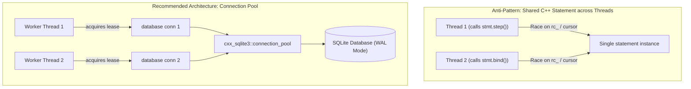

# Concurrency & Multithreading Architecture

> **Target Milestone: `cxx_sqlite3` Concurrency & Multi-Threading Extensions**  
> *Author: Yoel Monsalve & Antigravity*  
> *Status: In Discussion / Design Phase*

---

## 1. Executive Summary & Goals

In modern systems, applications rarely execute in single-threaded environments. Web servers, GUI applications (Qt, ImGui), game engines, and worker thread pools regularly access SQLite databases concurrently.

SQLite itself is capable of excellent concurrent throughput, but SQLite concurrency is **connection-centric**, not thread-centric. 

The goal of this design is to make `cxx_sqlite3`:
1. **Inherently Thread-Safe**: Clarify and enforce thread boundaries at compile-time and runtime.
2. **High-Throughput Concurrent (WAL-First)**: Provide native helpers for Write-Ahead Logging (WAL) to allow **infinite concurrent readers alongside a concurrent writer**.
3. **Resilient to Contention (`busy_timeout`)**: Built-in exponential backoff / timeout handlers so concurrent writers do not immediately throw `SQLITE_BUSY`.
4. **Ergonomic Resource Pooling (`connection_pool`)**: A modern C++ RAII connection pool providing leased connections to worker threads without redundant disk-reopening overhead.

---

## 2. SQLite Threading Reality & Model

SQLite operates in one of three engine modes:

| Mode | Flag | Threading Semantics |
| :--- | :--- | :--- |
| **Single-thread** | `SQLITE_CONFIG_SINGLETHREAD` | All internal mutexes disabled. Unsafe if multiple threads touch SQLite. |
| **Multi-thread** | `SQLITE_CONFIG_MULTITHREAD` | Mutexes enabled per connection. Multiple threads can access SQLite concurrently **provided each thread uses its own connection (`sqlite3*`)**. |
| **Serialized** | `SQLITE_CONFIG_SERIALIZED` *(Default)* | Mutexes enabled everywhere. Multiple threads may theoretically share a single `sqlite3*` handle, with SQLite serializing calls internally. |



### The C++ Wrapper Reality
Even in **Serialized** mode, sharing a single `cxx_sqlite3::database` or `statement` object across threads is an **anti-pattern**:
- `statement` holds mutable C++ state (`rc_`, `pStmt`, column caches, and input iterator cursors).
- `database` holds active transaction state. If Thread A calls `db.begin_transaction()`, queries from Thread B on the same `database` instance would inadvertently run inside Thread A's transaction!

**The Golden Architecture**: **Each thread must own or lease its own `cxx_sqlite3::database` instance.** SQLite handles the underlying file-level locks and concurrency safely between those connections.

---

## 3. Pillar 1: WAL Mode & Pragma Helpers

By default, SQLite uses a rollback journal, which locks the entire database file exclusively during writes (meaning **readers block writers, and writers block readers**).

In **WAL (Write-Ahead Logging)** mode:
- **Readers never block writers.**
- **Writers never block readers.**
- Readers read from the database and WAL log simultaneously, while a single writer appends transactions to the WAL log.

### Proposed API Additions to `class database`:

```cpp
class database {
public:
    /**
     * Enables Write-Ahead Logging (WAL) mode for maximum concurrent read/write throughput.
     * In WAL mode, concurrent readers do not block writers, and writers do not block readers.
     */
    void enable_wal() {
        exec("PRAGMA journal_mode=WAL;");
        exec("PRAGMA synchronous=NORMAL;"); // Optimal balance for performance & durability
    }

    /**
     * Returns true if the database connection is currently in WAL journal mode.
     */
    bool is_wal_mode() {
        statement st = query("PRAGMA journal_mode;");
        row r = st.fetch_row();
        return r[0].as<std::string>() == "wal";
    }
};
```

---

## 4. Pillar 2: Resilient Contention Handling (`busy_timeout`)

When multiple threads or processes attempt to acquire a write lock simultaneously, SQLite by default immediately fails with `SQLITE_BUSY` (`return_code::busy`).

Instead of crashing or throwing exceptions immediately, SQLite provides `sqlite3_busy_timeout`, which puts the contending thread to sleep for short intervals and retries up to a configured threshold.

### Proposed API:

```cpp
class database {
public:
    /**
     * Sets a busy handler that sleeps rather than returning SQLITE_BUSY immediately.
     * @param ms Maximum milliseconds to wait before yielding an error/exception.
     */
    void set_busy_timeout(int ms) {
        int rc = sqlite3_busy_timeout(conn, ms);
        if (rc != SQLITE_OK) {
            throw exception_step(sqlite3_errstr(rc));
        }
    }
};
```

A default timeout (e.g., 5000ms) will eliminate 99.9% of transient lock contention errors in multi-threaded workloads.

---

## 5. Pillar 3: RAII Connection Pool (`connection_pool`)

To prevent worker threads from repeatedly running slow disk opening, journal verification, and schema parsing (`sqlite3_open_v2`), `cxx_sqlite3` will introduce a thread-safe connection pool.

### Architecture

```cpp
namespace cxx_sqlite3 {

    class connection_pool {
    public:
        using lease = std::unique_ptr<database, std::function<void(database*)>>;

        /**
         * Creates a pool for the target database file.
         * @param filename Path to database.
         * @param max_connections Maximum connections in pool (e.g. std::thread::hardware_concurrency()).
         * @param busy_timeout_ms Auto-configured busy timeout for each connection.
         */
        connection_pool(const std::string &filename, 
                        size_t max_connections = 8, 
                        int busy_timeout_ms = 5000);

        /**
         * Acquires an active connection from the pool.
         * Blocks thread if all connections are currently leased.
         * Automatically returns connection to pool when lease goes out of scope (RAII).
         */
        lease acquire();

        /**
         * Current number of idle connections ready in pool.
         */
        size_t available() const noexcept;
    };
}
```

### Usage Example in Multithreaded Code

```cpp
// Initialize shared pool once
cxx_sqlite3::connection_pool pool("production.db", 16);

// Inside arbitrary worker threads:
void worker_task(int user_id) {
    // Acquire RAII lease (blocks if pool exhausted, auto-returns on function exit)
    auto db = pool.acquire();

    // Perform queries safely without interference
    for (const auto &row : db->query("SELECT balance FROM accounts WHERE id = ?", user_id)) {
        std::cout << "Balance: " << row["balance"].as<double>() << "\n";
    }
}
```

---

## 6. Pillar 4: Thread-Sanitizer Verification Suite

To guarantee that `cxx_sqlite3` is rock-solid under high concurrency:
1. Create `tests/test_concurrency.cpp` with 16 concurrent threads:
   - 12 threads performing continuous reads via `pool.acquire()`.
   - 4 threads performing concurrent transactions via `db->begin_transaction()`.
2. Add a `make test_tsan` Makefile target compiling with `-fsanitize=thread` to prove zero data races at runtime.

---

## 7. Implementation Roadmap

| Phase | Feature | Complexity | Key Benefit |
| :--- | :--- | :--- | :--- |
| **Step 1** | `db.enable_wal()` & `db.set_busy_timeout(ms)` | Low | Immediate 10x throughput boost for multi-threaded users |
| **Step 2** | `tests/test_concurrency.cpp` | Medium | Automated proof of thread safety under load |
| **Step 3** | `class connection_pool` | Medium | Zero-allocation connection reuse for thread pools & web servers |
| **Step 4** | Thread-Sanitizer (`-fsanitize=thread`) Target in Makefile | Low | Continuous verification against race conditions |
