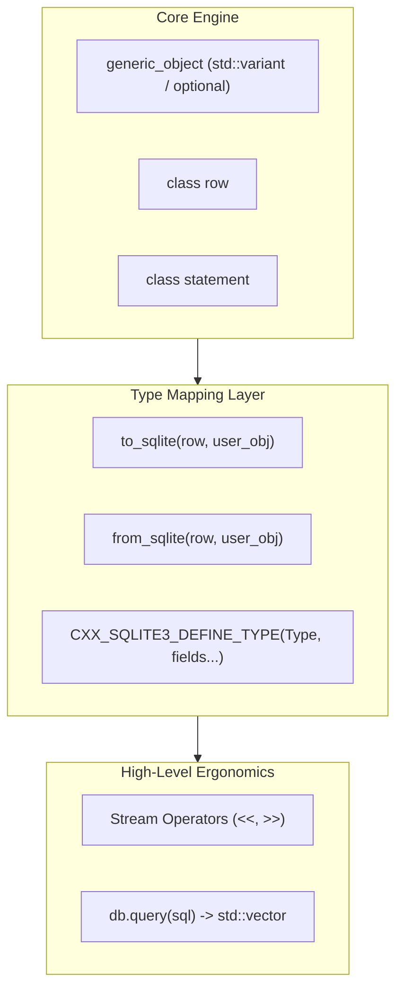
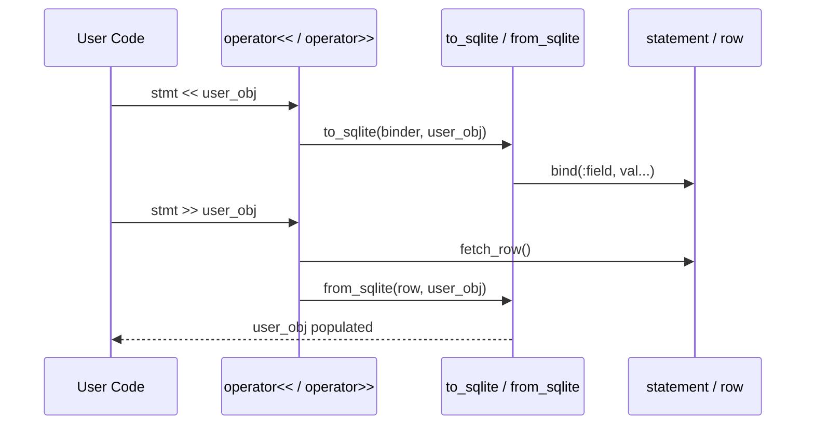

# Architectural Roadmap: Reaching the "Nlohmann Standard" for SQLite

> **Target Milestone: `cxx_sqlite3` v2.0 Architecture & Feature Proposals**  
> *Author: Yoel Monsalve & Antigravity*  
> *Status: In Discussion / Design Phase*

---

## 1. Executive Summary & Vision

Niels Lohmann's `nlohmann/json` revolutionized JSON in modern C++ because it eliminated the barrier between native C++ types and data transfer formats. Working with JSON felt like interacting directly with standard C++ containers.

Our vision for `cxx_sqlite3` is to deliver that exact developer experience for relational database persistence:
- **Zero-Boilerplate Serialization**: Seamless bi-directional mapping between arbitrary C++ structs/classes and SQLite rows via `to_sqlite` and `from_sqlite`.
- **Stream-Driven Syntax (`<<` / `>>`)**: Natural input and extraction operators unifying CLI ergonomics with C++ stream idioms, built on top of the same serialization engine (strictly adhering to the DRY principle).
- **Modern Standards Typing**: Native support for `std::variant`, `std::optional`, and `std::tuple` to model nullable columns and multi-column queries with zero sentinel hacks.
- **Single-Header Distribution (`cxx_sqlite3.hpp`)**: Zero-dependency drop-in inclusion.



---

## 2. Pillar A: Object-Relational Serialization (`to_sqlite` & `from_sqlite`)

### 2.1 The Philosophy
Rather than requiring a heavyweight ORM with reflection engines, code generators, or complex XML configurations, `cxx_sqlite3` will employ **Argument-Dependent Lookup (ADL) customization points**, exactly as `nlohmann/json` does with `to_json` / `from_json`.

### 2.2 The ADL Interface
For any user-defined type `T`, users can provide conversion free functions in the same namespace as `T`:

```cpp
namespace my_app {
    struct User {
        int id;
        std::string name;
        double salary;
        std::optional<std::string> email; // Nullable column
    };

    // Serializer: Object -> SQLite statement / row parameters
    inline void to_sqlite(cxx_sqlite3::row_binder &binder, const User &u) {
        binder.bind(":id", u.id,
                    ":name", u.name,
                    ":salary", u.salary,
                    ":email", u.email);
    }

    // Deserializer: SQLite row -> Object
    inline void from_sqlite(const cxx_sqlite3::row &r, User &u) {
        u.id     = r["id"].as<int>();
        u.name   = r["name"].as<std::string>();
        u.salary = r["salary"].as<double>();
        u.email  = r["email"].as<std::optional<std::string>>();
    }
}
```

### 2.3 Non-Intrusive Helper Macro
To eliminate boilerplate for straightforward structs, provide a non-intrusive macro:

```cpp
CXX_SQLITE3_DEFINE_TYPE_NON_INTRUSIVE(my_app::User, id, name, salary, email)
```

### 2.4 Strongly-Typed Queries
With `from_sqlite` in place, `db.query<T>` automatically populates containers:

```cpp
// Queries directly into a vector of native structs:
std::vector<User> engineers = db.query<User>("SELECT * FROM users WHERE salary > ?", 8000.0);

for (const auto &u : engineers) {
    std::cout << u.name << " ($" << u.salary << ")\n";
}
```

---

## 3. Pillar B: Stream Insertion & Extraction Operators (`<<` and `>>`)

### 3.1 Unifying Streams with Serialization (The DRY Principle)
Stream operators will **not** maintain separate parsing or binding logic; they will directly wrap the `to_sqlite` and `from_sqlite` pipelines:



### 3.2 SQL Statement Pipelining (`<<`)
Binding values sequentially or in named pairs:
```cpp
// Pipelining query creation & immediate execution
db << "INSERT INTO users (id, name, salary) VALUES (?, ?, ?)"
   << 1 << "Alice" << 4500.0
   << cxx_sqlite3::exec;

// Pipelining a structured object directly
User bob{2, "Bob", 6200.0, "bob@example.com"};
db << "INSERT INTO users VALUES (:id, :name, :salary, :email)"
   << bob
   << cxx_sqlite3::exec;
```

### 3.3 Extraction Pipelining (`>>`)
Reading rows sequentially into objects or primitives:
```cpp
statement query = db.prepare_statement("SELECT id, name, salary FROM users ORDER BY id ASC");

User u;
while (query >> u) {
    // query >> u internally executes step(), extracts into row, and calls from_sqlite(row, u)
    // returns true as long as another row is available (error::row)
    process(u);
}
```

---

## 4. Pillar C: Modern Type System (`std::variant`, `std::optional`, `std::tuple`)

### 4.1 Upgrading `generic_object` to `std::variant`
Currently, `generic_object` uses manual unions/fields:
```cpp
// Current internal representation:
type_tag type_;
int64_t int_val_;
double double_val_;
std::string text_val_;
blob_t blob_val_;
```

In the modern standard pipeline (C++17 and above), `generic_object` will transition to a lightweight, type-safe tagged union:
```cpp
using value_variant = std::variant<
    std::nullptr_t,
    int64_t,
    double,
    std::string,
    std::vector<uint8_t>
>;
```
This guarantees zero memory overhead, no undefined behavior during moves/copies, and enables expressive `std::visit` visitor pattern implementations.

### 4.2 First-Class Nullability: `std::optional<T>`
Instead of sentinel defaults (like returning `0` or `""` for `NULL`), developers can request `std::optional`:

```cpp
// If column is SQL NULL, returns std::nullopt without exceptions:
std::optional<int> age = row["age"].as<std::optional<int>>();

if (age.has_value()) {
    std::cout << "Age: " << *age << "\n";
} else {
    std::cout << "Age: not specified\n";
}
```

### 4.3 Direct Tuple Deconstruction
Support direct unpacking of anonymous column projections:
```cpp
// Fetch single row as std::tuple
auto [id, name, salary] = row.as<std::tuple<int, std::string, double>>();
```

---

## 5. Pillar D: Single-Header Distribution (`cxx_sqlite3.hpp`)

`nlohmann/json` became the default choice in millions of codebases because adding it requires:
1. Downloading one file: `json.hpp`.
2. `#include "json.hpp"`.
3. Done.

### Implementation Strategy:
1. Maintain the modular multi-header architecture in `include/` during development for clean maintenance and fast compilation.
2. Provide an amalgamation script (`scripts/amalgamate.py`) that merges:
   - `include/basic_types.hpp`
   - `include/object.hpp`
   - `include/error_code.hpp`
   - `include/exception.hpp`
   - `include/sqlite.hpp`
   - Inline definitions of static members from `src/sqlite.cpp` using `inline` (C++17) or header-safe guards.
3. Generate a release artifact: `single_include/cxx_sqlite3.hpp`.

---

## 6. Implementation Roadmap

| Phase | Milestone | Scope | Target Standard |
| :--- | :--- | :--- | :--- |
| **v1.1** | `std::optional` & `std::variant` Refactor | Modernize `generic_object` storage and add `as<std::optional<T>>()` | C++14 / C++17 |
| **v1.2** | Object Serialization Engine | Implement ADL `to_sqlite` / `from_sqlite` and `CXX_SQLITE3_DEFINE_TYPE` | C++17 |
| **v1.3** | Stream Operators (`<<` / `>>`) | Add streaming interface wrapping serialization pipeline | C++17 |
| **v2.0** | Single-Header Release | Automated amalgamation script and release of `cxx_sqlite3.hpp` | C++17 / C++20 |

---

## 7. Open Questions for Discussion
1. **Fallback for Pre-C++17**: Should `cxx_sqlite3` maintain a lightweight custom `optional` and `variant` fallback for pure C++11 environments, or should v2.0 formally adopt C++17 as the baseline?
2. **Field Reflection**: When C++26 static reflection matures, should `to_sqlite` and `from_sqlite` become 100% automatic with zero macros?
